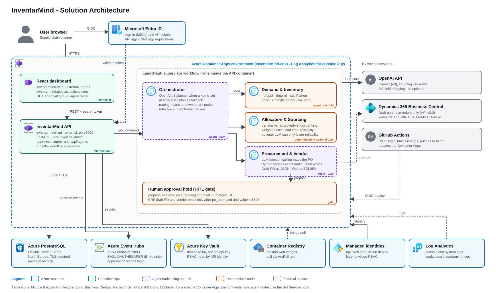

# InventarMind

Human-supervised multi-agent supply-chain replenishment: a React dashboard, a FastAPI API, a LangGraph agent workflow, PostgreSQL, Kafka events, and Azure deployment via Terraform and GitHub Actions.

## Current cloud deployment

InventarMind is deployed to Azure (resource group `rg-inventarmind`, Sweden Central) and managed with Terraform.

| Item | Value |
| --- | --- |
| Web app | https://inventarmind.giddyitsolutions.com (CNAME at name.com, managed certificate) |
| API | `inventarmind-api` Container App, `/health` reports healthy |
| Auth | Microsoft Entra ID (API app + SPA app registration, scope `access_as_user`) |
| Database | Azure Database for PostgreSQL Flexible Server (B1ms, North Europe) |
| Events | Event Hubs Kafka endpoint, Entra-only (SASL OAUTHBEARER via managed identity) |
| Secrets | Key Vault (`database-url`, `openai-api-key`), read by managed identity |
| CI/CD | GitHub Actions with OIDC builds images, pushes to ACR, updates the Container Apps |
| ERP | Business Central Draft POs; writes are **off** (`BC_WRITES_ENABLED=false`) |

## Solution Architecture



### Azure resources

- Container Apps environment `inventarmind-env` with `inventarmind-api` (port 8000) and `inventarmind-web` (port 80)
- Container Registry, Key Vault (RBAC), Log Analytics `inventarmind-logs`
- Event Hubs namespace with `inventory-events` and `approval-decisions` (local auth disabled)
- PostgreSQL Flexible Server, database `supply_chain`
- User-assigned managed identities for the API, web app and GitHub deploy

### Agents

| Node | LLM? | Role |
| --- | --- | --- |
| Orchestrator | Optional (OpenAI `o3`) | Decomposes the objective, routes tasks, retries twice then escalates to a human |
| Demand & Inventory | No | Deterministic stockout deficit = max(0, safety - on_hand) |
| Allocation & Sourcing | Optional | Deterministic transfer/vendor ranking; the LLM can only lower supplier reliability |
| Procurement & Vendor | Yes | Function calling builds the PO payload; Python verifies it, and dispatch requires `po_approved`, value < $50k and a vendor email |

Proposals wait in the approval queue; nothing is written to the ERP without human approval.

### Known gaps

- Approving a vendor proposal records a held PO handoff, but does not yet trigger a Business Central write.
- The Kafka consumer only logs events; inventory events do not yet feed the workflow.
- Live OpenAI calls are untested; the planner is active only once `openai-api-key` exists in Key Vault.
- Vendor email sending and acknowledgement checks are placeholders.
- `infra/k8s` is an unused alternative to Container Apps.
## Run locally

Requirements: Docker Desktop with Compose.

```powershell
Copy-Item .env.example .env
docker compose up --build
```

Open [http://localhost:5173](http://localhost:5173). The local profile leaves API authentication disabled so the app works without cloud credentials. To use Entra ID locally, set `AUTH_ENABLED=true` and configure the frontend and API values in `.env`; register a single-page application and expose the API scope `access_as_user`.

The API is available at [http://localhost:8000](http://localhost:8000), with OpenAPI docs at `/docs`. The consumer logs inventory and approval events from Kafka. Enter a high-level objective in the dashboard and run the supervisor workflow, then review the resulting proposal in the approval queue. The starter currently runs against demo inventory inputs.

The supervisor uses the configured OpenAI reasoning model when `OPENAI_API_KEY` is set (`ORCHESTRATOR_MODEL=o3`, `ORCHESTRATOR_REASONING_EFFORT=high` by default). Without a key, it uses a deterministic plan and records that choice. It never logs or returns hidden chain-of-thought; only a short plan summary is recorded. Failed agent nodes are retried up to two times before being routed to human review.

## Business Central (ERP)

`agents/tools/business_central.py` is the ERP adapter used by `procurement_vendor.py`. It creates **Draft** purchase orders through the Business Central API v2.0 (`purchaseOrders` and `purchaseOrderLines`) using Entra client-credentials. It is disabled unless `BC_WRITES_ENABLED=true` and the `BC_*` variables are set; it never releases or posts a PO. Register an Entra app, grant it the Business Central API permission, and add it to Business Central (Microsoft Entra Applications page) with a permission set limited to purchase documents. Store `BC_CLIENT_SECRET` in Key Vault, not in `.env`.

## Authentication

When authentication is enabled, approval and rejection decisions require the
`PurchaseOrder.Approver` application role in the API access token. Define this
role on the API app registration, assign it to the appropriate users or groups
in the API enterprise application, and have those users acquire new tokens
before deploying this change. Without the role, decision requests return 403;
reading the queue remains available to authenticated users. Local development
with authentication disabled does not enforce the role. Approval does not yet
dispatch a Business Central purchase order. Vendor approvals create a durable,
held handoff containing the approved proposal, approver, timestamp and a unique
reference in the same database transaction as the decision. There is no dispatcher
yet, so a held handoff does not mean a draft exists in Business Central.
The API creates the new `purchase_order_dispatches` table at startup; its
database identity must have permission to create tables. Existing approved
proposals are not automatically backfilled.

For deployments, set `AUTH_ENABLED=true`, `ENTRA_TENANT_ID`, and `ENTRA_API_CLIENT_ID` in the API environment. Configure `VITE_AUTH_ENABLED=true`, `VITE_ENTRA_TENANT_ID`, `VITE_ENTRA_CLIENT_ID`, and `VITE_ENTRA_API_SCOPE` for the frontend. The API validates Entra-issued RS256 access tokens, including issuer and audience. Do not use the local unauthenticated profile in a reachable environment.

## Repository map

```text
frontend/                 React HITL dashboard and approval queue
backend/src/              FastAPI routes, database, Kafka producer and consumer
agents/                   LangGraph state, workflow, nodes, and agent tools
infra/terraform/          Azure infrastructure (Container Apps, PostgreSQL, Event Hubs, Key Vault)
infra/k8s/                 Kubernetes manifests
.github/workflows/         Image build and Container Apps deploy (OIDC)
docs/                      Solution architecture diagram
```

## Azure deployment

1. **Terraform** (from `infra/terraform`; copy `terraform.tfvars.example` to `terraform.tfvars`). Supply secrets through the environment, never files:

   ```powershell
   $env:TF_VAR_postgres_admin_password = Read-Host -MaskInput "Postgres password"
   $env:TF_VAR_openai_api_key = Read-Host -MaskInput "OpenAI API key"
   terraform init; terraform plan; terraform apply
   ```

   State is local and contains the database password; it is gitignored. Consider a remote backend.
2. **GitHub Actions**: the deploy identity uses OIDC federation. Set the secrets `AZURE_CLIENT_ID`, `AZURE_TENANT_ID`, `AZURE_SUBSCRIPTION_ID` and the variables listed in `.github/workflows/deploy.yml`. Pushes to `main` build and roll out new images only; Terraform changes are applied manually.
3. **Custom domain** (frontend only): at the DNS host add `CNAME inventarmind` -> the web Container App FQDN and `TXT asuid.inventarmind` -> the environment verification ID, then run `az containerapp hostname add` and `az containerapp hostname bind` for a managed certificate. Add the new origin to `CORS_ORIGINS` and the SPA redirect URIs in Entra.
## Development checks

```powershell
python -m pytest backend/tests
npm --prefix frontend install
npm --prefix frontend run build
```

See `.env.example` for local settings. Never commit `.env` or production credentials.
